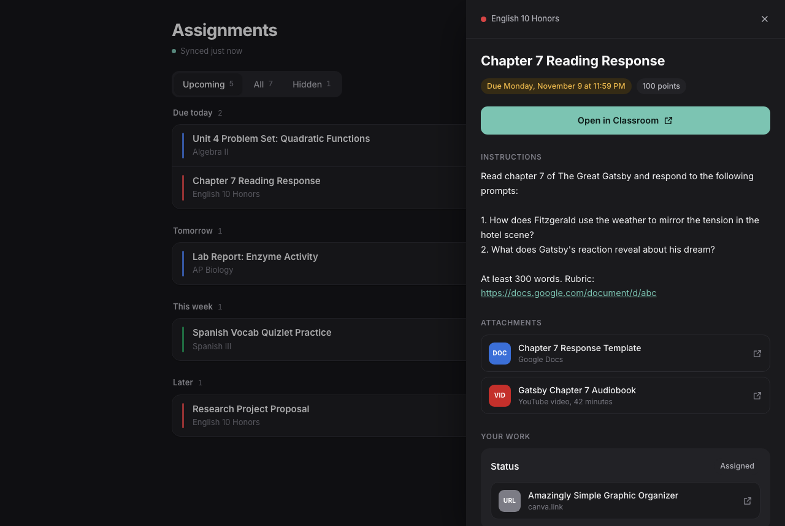

# gclass

**See your upcoming Google Classroom assignments on your own private website.** Check it from your phone,
another computer, anywhere.


<sub>(Screenshot uses made-up sample assignments.)</sub>

- **Upcoming:** what's due today, tomorrow, this week and later
- **All:** everything, including assignments with no due date, with search and a class filter
- **Click an assignment:** see the instructions, attached files, your work's status, and an *Open in Classroom* button
- **Hide** anything that isn't real work (like "Test tomorrow, here's a study guide!") with the X button
- Past-due work and no-due-date posts older than a week are left out automatically
- Works in light and dark mode, on desktop and phone

---

## How it works

```
 Your computer                                 Cloudflare (free)                 Any device
┌─────────────────────────────┐   uploads    ┌───────────────────────┐   view   ┌──────────────┐
│ Chrome, signed in to        │ ───────────▶ │ Your own private site │ ───────▶ │ Phone, laptop │
│ Classroom + this extension  │  every 30min │ https://gclass.<you>  │          │ (needs key)   │
└─────────────────────────────┘              │       .workers.dev    │          └──────────────┘
                                             └───────────────────────┘
```

1. A **Chrome extension** on your computer reads your Classroom **To-do** page using the Google login you
   already have in Chrome. Your Google password is never typed into, stored by, or sent to anything.
2. Every 30 minutes, while Chrome is open, it sends your assignment list to **your own website**, which runs for
   free on Cloudflare.
3. You open that website from any device and enter your **access key** (a password the setup makes for you).

Everyone who uses this sets up their **own** copy. Your assignments only go to your own Cloudflare account.

---

## What you need

| | |
|---|---|
| **A computer** | Windows 10/11, macOS, or Linux. You do the setup once; after that it just needs Chrome open sometimes. |
| **Google Chrome** | Microsoft Edge or Brave also work (they're built on Chrome). **Firefox and Safari won't work.** |
| **Node.js 20 or newer** | Free. Used only during setup. Step 1 shows how to install it. |
| **A free Cloudflare account** | You can create one during setup. No credit card needed. |
| **About 15 minutes** | |

> **School-issued Chromebooks usually won't work.** Schools normally block installing your own extensions
> and running setup tools on them. Use a personal computer.

---

## Step 1: Install Node.js

Skip this if you already have Node.js 20 or newer. To check, run `node -v` in a terminal (step 2 shows how to
open one).

<details open>
<summary><b>Windows</b></summary>

1. Go to **https://nodejs.org** and download the **LTS** version (the big green button). You'll get a `.msi` file.
2. Open it and click **Next** through the installer. The default options are fine.
3. **Close and reopen** any terminal windows you had open so they can find Node.

Or, if you prefer the command line, open **PowerShell** and run: `winget install OpenJS.NodeJS.LTS`
</details>

<details open>
<summary><b>macOS</b></summary>

1. Go to **https://nodejs.org** and download the **LTS** version. You'll get a `.pkg` file.
2. Open it and follow the installer.

Or, if you use [Homebrew](https://brew.sh): `brew install node`
</details>

<details open>
<summary><b>Linux</b></summary>

Your distro's package may be too old, so use the official instructions at **https://nodejs.org/en/download**.
Choose your OS and "nvm", then copy the commands it shows. For example:

```bash
curl -o- https://raw.githubusercontent.com/nvm-sh/nvm/v0.40.3/install.sh | bash
# close and reopen your terminal, then:
nvm install --lts
```
</details>

Check that it worked: in a **new** terminal window, `node -v` should print `v20` or higher.

---

## Step 2: Download this project and open a terminal in it

**Download:** on this GitHub page, click the green **Code** button, then **Download ZIP**. Unzip it somewhere
easy to find, like your Documents folder.
(If you use git: `git clone https://github.com/faarisaahmed/gclass.git`)

**Open a terminal inside the folder** (the one that contains `package.json`):

<details open>
<summary><b>Windows</b></summary>

Open the unzipped folder in File Explorer, click the **address bar** at the top, type `cmd` and press **Enter**.
A Command Prompt opens in that folder.

> Use **Command Prompt** rather than PowerShell for the next step. PowerShell sometimes says
> *"running scripts is disabled on this system"*. If you do use PowerShell and see that, type `npm.cmd`
> instead of `npm`.
</details>

<details open>
<summary><b>macOS</b></summary>

Open **Terminal** (press Cmd+Space, type "Terminal", press Enter). Type `cd ` (with a space after it), drag the
unzipped folder onto the Terminal window, and press **Enter**.
</details>

<details open>
<summary><b>Linux</b></summary>

Right-click inside the folder in your file manager and choose **Open in Terminal**, or `cd` into it.
</details>

---

## Step 3: Run the setup

In that terminal, run:

```
npm run setup
```

It walks you through everything:

1. **Installs** what it needs (takes a minute the first time).
2. **Opens your browser to sign in to Cloudflare.** Sign in, or click *Sign up* to make a free account. Then
   click **Allow** and come back to the terminal.
3. **Asks a few questions.** Press **Enter** to accept the default in `[brackets]`:
   - **Site name:** `gclass` is fine. Your site will be `https://gclass.<your-subdomain>.workers.dev`.
   - **School Google email:** optional. Fill it in if your Chrome is signed in to more than one Google
     account (for example, personal and school), so the extension uses the right one.
   - **Timezone:** detected automatically.
4. **Publishes your site** and creates your **access key**.

At the end it prints your **site URL** and **access key**. Both are also saved in a file called `MY-SITE.txt`
in the project folder.

> **"You need a workers.dev subdomain"?** New Cloudflare accounts sometimes need one extra click. Go to
> https://dash.cloudflare.com, click **Workers & Pages** in the left sidebar, choose a subdomain when it asks
> (this becomes part of your site's address), then run `npm run setup` again.

---

## Step 4: Install the Chrome extension

1. In Chrome, go to **`chrome://extensions`** (type it in the address bar).
   - Edge: `edge://extensions`. Brave: `brave://extensions`.
2. Turn on **Developer mode** (a switch in the top-right corner; in Edge it's on the left).
3. Click **Load unpacked**.
4. Choose the **`extension`** folder *inside* the project folder, then click **Select** (or **Open**).
5. **Classroom To-do Sync** now appears in your extensions list. Click the **puzzle-piece icon** in Chrome's
   toolbar, then the **pin** next to *Classroom To-do Sync*, so its icon is always visible.

Setup already filled in your site URL and access key. Click the extension's icon to check that they're there.

> Chrome might show a banner about "developer mode extensions". That's normal for extensions you install
> yourself. You can close it.

---

## Step 5: First sync

1. In the **same Chrome**, go to **https://classroom.google.com** and make sure you're signed in to your school
   account.
2. Click the extension icon, then **Sync now**.
3. Wait 1 to 3 minutes. A pinned Classroom tab will appear and disappear on its own while it reads your
   assignments. Leave it alone. You can close the popup.
4. When the popup says **"Synced …"**, you're done.

---

## Step 6: Open your site

Go to your site URL (from `MY-SITE.txt`) on any device and enter your **access key**. It remembers you for 90 days.

**Add it to your phone's home screen** so it opens like an app:
- **iPhone (Safari):** tap the **Share** button, then **Add to Home Screen**.
- **Android (Chrome):** tap the **⋮** menu, then **Add to Home screen**.

---

## Everyday use

- **Keep Chrome open** on your computer, with any window (it doesn't need to be on Classroom). The extension
  syncs every 30 minutes. If Chrome is fully closed, your site keeps showing the last list and its
  "Synced … ago" label turns yellow.
- **Want it updated right now?** Click the extension icon, then **Sync now**.
- **Hide** something with the **X** on its row. Find it again in the **Hidden** tab and click **Restore**.
- The first sync reads up to 15 assignment pages. Later syncs only read new ones and re-check each one about
  twice a day.

---

## Updating to a newer version

1. Get the new files: `git pull`, or download the ZIP again and unzip it **over** your old folder. Your settings
   are in files the download doesn't include (`.setup.json`, `wrangler.toml`, `extension/config.js`), so keep
   using the same folder.
2. In a terminal in the folder, run `npm run setup` again. It remembers your answers and just republishes.
3. Go to `chrome://extensions` and click the **reload arrow** on *Classroom To-do Sync*.

---

## Troubleshooting

| Problem | Fix |
|---|---|
| `'node' is not recognized` / `command not found: npm` | Node.js isn't installed, or the terminal was open before you installed it. Close the terminal, open a new one, and try again. |
| PowerShell: *"running scripts is disabled on this system"* | Use Command Prompt instead, or type `npm.cmd run setup`. |
| Setup: *"You need a workers.dev subdomain"* | See the note at the end of Step 3. |
| Popup: *"Not signed in to Google Classroom in this Chrome profile"* | Sign in at classroom.google.com **in the same Chrome profile** the extension is installed in. |
| It synced the wrong Google account | Click the extension icon, type your school email in **School Google email**, click **Save**, then **Sync now**. |
| Popup: *"Fill in the Site URL and access key"* | Copy them from `MY-SITE.txt` into the popup and click **Save**. |
| Site says "Synced 5 hr ago" and isn't updating | Chrome on your computer was closed or asleep. Open it and click **Sync now**. |
| An assignment's instructions say "haven't synced yet" | Its page hasn't been read yet. Wait for the next sync or click **Sync now**. |
| Titles, dates or classes look wrong | Google may have changed Classroom's layout. Check for an updated version of this project. |
| Lost your access key | It's in `MY-SITE.txt` and `.setup.json` in the project folder. |
| "Load unpacked" is missing or greyed out | Turn on **Developer mode** first. If you can't (school-managed browser), use a personal computer or Chrome profile. |

---

## Privacy and safety

- Your **Google password is never used.** The extension reads Classroom pages in your own browser, the same
  way you see them.
- Your assignments are only sent to **your own** Cloudflare site, which is protected by your access key. Nobody
  else, including whoever made this project, can see them.
- **Keep your access key private.** Don't share `MY-SITE.txt`, `.setup.json` or `extension/config.js`. They're
  already excluded from git.
- The extension can only access `classroom.google.com` and `*.workers.dev`.
- This is an unofficial personal project. It isn't made by or affiliated with Google. It only *reads*
  Classroom; it can't turn in or change anything.

**Cost:** Cloudflare's free plan covers this easily (around 100 storage writes a day out of 1,000 free).

## Uninstalling

- **Extension:** `chrome://extensions`, then **Remove** on *Classroom To-do Sync*.
- **Website:** at https://dash.cloudflare.com, go to **Workers & Pages**, click your site, then **Settings**,
  then **Delete**. Also delete its storage under **Storage & Databases → KV**.

---

## For developers

| Path | What it is |
|---|---|
| `src/index.js` | The Cloudflare Worker: the site, login, and the `/api/*` endpoints the extension posts to. |
| `extension/` | Manifest V3 Chrome extension. `background.js` runs the sync; `content.js` scrapes Classroom pages. |
| `scripts/setup.mjs` | Cross-platform setup (Cloudflare login, KV, deploy, secret, extension config). |
| `wrangler.example.toml` | Template that setup copies to `wrangler.toml`. |

The scraper targets Classroom's To-do page (`/a/not-turned-in/all`) and assignment pages
(`/c/<class>/a/<id>/details`). Classroom's CSS class names change from time to time. If scraping breaks,
`content.js` has the selectors, and each one has a text-based fallback.
